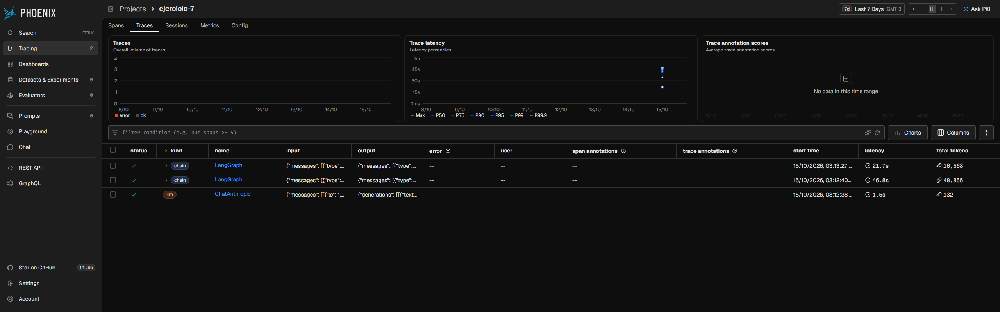
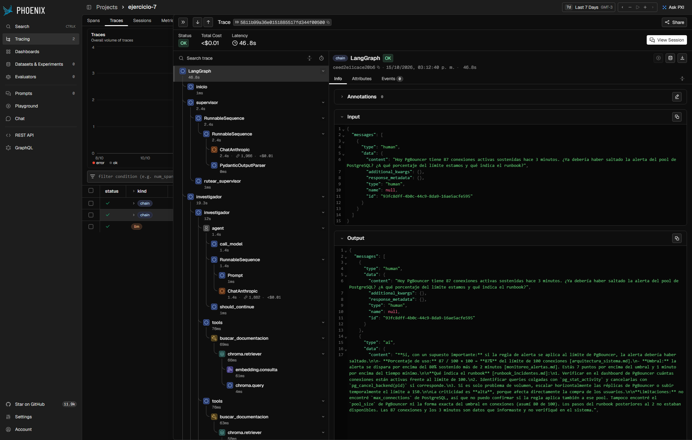
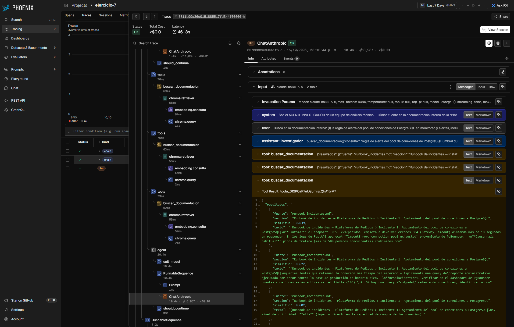
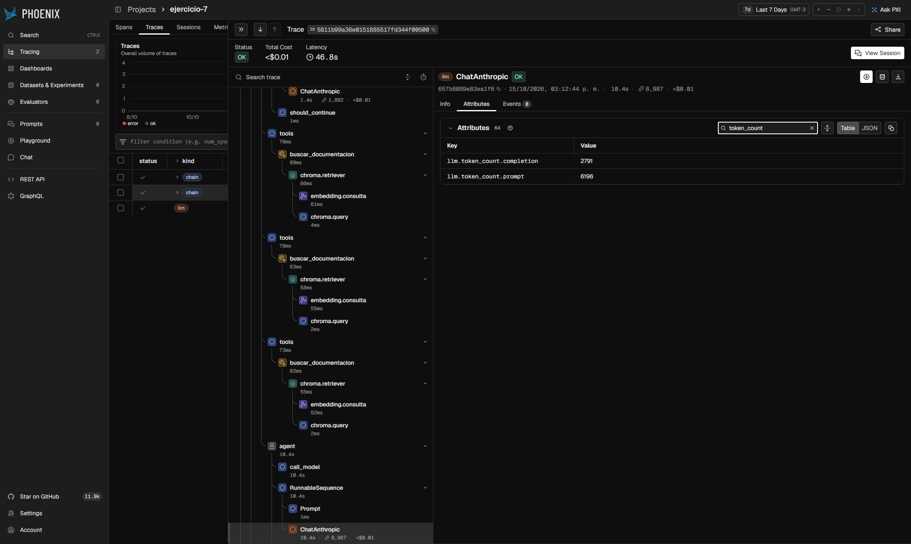
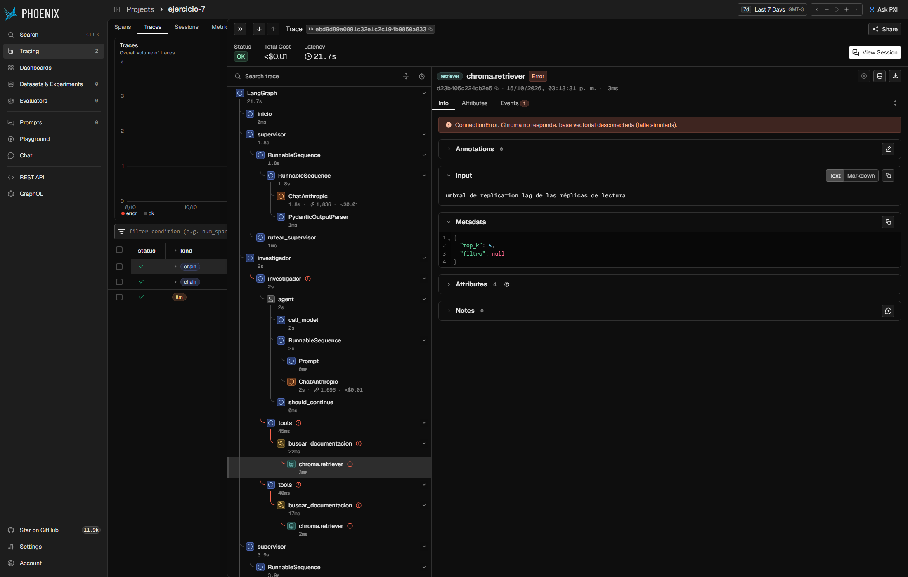

# Instrumentación y análisis de trazas con Phoenix

Ejercicio del Módulo 7 de AI Engineering (Coderhouse).

Se instrumentó con **Arize Phoenix** (OpenTelemetry + OpenInference) el orquestador multiagente del
Módulo 6: un supervisor en LangGraph que delega en un investigador (búsqueda en ChromaDB) y en un
analista (cálculos), valida con una rúbrica y cierra con un sintetizador.

## 1. Script reproducible: `ejercicio7.py`

```bash
python -m venv .venv
.venv/Scripts/pip install -r requirements.txt   # en Linux/macOS: .venv/bin/pip
cp .env.example .env                            # completar ANTHROPIC_API_KEY
python ejercicio7.py                            # en Windows conviene PYTHONUTF8=1
```

El script hace, en orden:

1. **Inicialización limpia de Phoenix** con `px.launch_app(use_temp_dir=True)`: una base temporal
   y vacía en cada corrida, así la tabla muestra solo las trazas de esa corrida. Corre en un proceso
   hijo, porque en un hilo del mismo proceso que el agente el servidor dejaba de aceptar spans (503).
2. **`TracerProvider` propio** de OpenTelemetry con el proyecto `ejercicio-7`, que exporta por OTLP a
   Phoenix con un `BatchSpanProcessor`, y **`LangChainInstrumentor().instrument(tracer_provider=provider)`**.
   Los spans manuales de `observability.py` (RETRIEVER, EMBEDDING y la query a Chroma) usan el
   mismo provider.
3. **Tres consultas variadas**:
   - **simple**: una sola llamada al LLM, sin recuperación ("¿para qué sirve un pool de conexiones
     como PgBouncer?");
   - **con recuperación documental**: el orquestador busca en ChromaDB los umbrales de la alerta del
     pool de PostgreSQL y calcula a qué porcentaje del límite están 87 conexiones;
   - **caso de error**: una consulta sobre replication lag con la base vectorial "desconectada"
     (`ConnectionError` provocado en `tools/custom_tools.py`).
4. Imprime un resumen por traza y lo guarda en [`analisis/ejercicio7/`](analisis/ejercicio7/)
   (`resumen.txt` y `spans.csv` con todos los spans). Phoenix queda abierto en
   http://localhost:6006 para sacar las capturas, hasta Ctrl+C.

El puerto 6006 tiene que estar libre (cerrar otro Phoenix antes).

## 2. Evidencia visual

**Vista general (Trace Table):** las tres ejecuciones con su latencia total y su conteo de tokens.



**Vista detallada, span raíz:** la traza con recuperación documental. La raíz es el CHAIN
`LangGraph` (46,8 s) y debajo están los nodos del grafo (`supervisor`, `investigador`...).



**Spans internos e inferencia:** el árbol desglosado muestra `buscar_documentacion` (TOOL), su
`chroma.retriever` (RETRIEVER) y, adentro, `embedding.consulta` (EMBEDDING) y `chroma.query`. Está
seleccionado el span LLM más lento de la traza (`ChatAnthropic` del investigador, 10,4 s). El panel
lateral muestra el modelo (`claude-haiku-5-5`), los parámetros de invocación y los mensajes de
entrada, incluidos los fragmentos devueltos por Chroma.



**Metadatos del span de inferencia:** en la pestaña Attributes, los tokens de prompt (6.196) y de
completion (2.791) de esa llamada.



**Caso de error:** el `chroma.retriever` falla con `ConnectionError` y el error se propaga en rojo
por `buscar_documentacion`, `tools` y el `investigador`. La traza termina OK porque el supervisor
maneja la falla y la respuesta la explica.



## 3. Análisis crítico

| Traza | Spans | Latencia | Tiempo en spans LLM | Recuperación | Tokens entrada / salida | Costo |
|---|---|---|---|---|---|---|
| simple | 1 | 1,6 s | 1,6 s | — | 49 / 83 | USD 0,00005 |
| con recuperación | 89 | 46,9 s | 46,6 s | 0,18 s | 38.711 / 10.144 | USD 0,0089 |
| caso de error | 83 | 21,8 s | 21,5 s | 0,01 s | 13.729 / 2.839 | USD 0,0028 |

Precio de `claude-haiku-5-5`: USD 0,10 por millón de tokens de entrada y USD 0,50 por millón de salida.

**Desglose de latencia.** Casi todo el tiempo es la llamada externa al LLM. En la traza con
recuperación, los 11 spans LLM suman 46,6 de los 46,9 s (99 %). La recuperación completa, con tres
búsquedas, tardó 0,18 s: el embedding de la consulta en CPU, unos 55 ms por búsqueda, y la query a
Chroma, de 2 a 4 ms. El procesamiento local del grafo (nodos, ruteo, parseo de la salida
estructurada, validación) suma el resto, alrededor de 0,1 s. En el caso de error, cada búsqueda
falla en 2 a 3 ms, pero la traza igual dura 21,8 s: el tiempo se va en las vueltas del supervisor y
del investigador que reintentan, no en la falla.

**Consumo de tokens y costos.** El tamaño del prompt no explica la latencia; los tokens generados,
sí. Con las 21 llamadas de la corrida, la duración de cada llamada se ajusta a
`≈ 1,18 s + 3,4 ms × tokens de salida` (R² 0,97). El span más caro lo confirma: el investigador
recibió 6.196 tokens de prompt (instrucción más fragmentos de Chroma) y generó 2.791, y tardó
10,4 s, lo que el ajuste predice casi exacto. La consulta simple genera 83 tokens y tarda 1,6 s. En
total entran 4 tokens por cada uno que sale, porque cada vuelta reenvía el contexto acumulado, pero
la salida cuesta 5 veces más por token. Por eso, en la traza con recuperación la salida es el 57 %
del costo (USD 0,0051 contra 0,0039 de la entrada). Todo sigue siendo barato: unos USD 0,012 por las
tres consultas.

**Cuello de botella.** El punto más sensible es la generación de tokens del LLM en la inferencia
remota, multiplicada por la cantidad de llamadas secuenciales que hace el grafo: 11 llamadas en una
sola pregunta. No es la latencia de red, porque el ida y vuelta a la API es de decenas de
milisegundos y la ordenada al origen de 1,2 s incluye el tiempo hasta el primer token. Tampoco es el
cómputo de embeddings en CPU, que con ~55 ms por búsqueda pesa menos del 0,5 %. Optimizar el
embedding o Chroma no movería la latencia total. Las palancas que sí la mueven son:
- limitar la salida de los especialistas: el investigador redacta informes de 2.000 a 2.800 tokens
  que después el supervisor resume;
- evitar vueltas del supervisor;
- no reintentar errores que no son transitorios: en el caso de error, los reintentos no servían
  porque la base seguía caída.

Para el costo de entrada, el contexto que se reenvía en cada vuelta es candidato a prompt caching.

## 4. Trabajo adicional

Además del script del ejercicio:
- se corrió la demo completa del orquestador (7 turnos) en dos sesiones de Phoenix;
- se evaluó el grounding de cada respuesta contra los fragmentos recuperados;
- se corrigieron tres defectos del grafo que la traza dejó a la vista: el log del tope de
  delegaciones, el validador inconsistente y el sintetizador ante fallas técnicas.

El análisis está en el documento
[Instrumentación y análisis de trazas con Phoenix](https://claude.ai/code/artifact/f21f3287-4219-49ea-85d8-56fae96224fb).

- `observability.py`: el instrumentador y los spans manuales de recuperación.
- `main.py --proyecto <nombre> [--falla]`: la demo completa, que envía las trazas a un Phoenix ya
  levantado con `python -m phoenix.server.main serve`.
- `analisis/`: los scripts de latencia, tokens, costo y grounding, y los resultados de las sesiones 2
  y 3.
- Tests: `python -m pytest` (45 tests, sin llamadas a la API) y `python -m mypy`.

Notas:
- `anthropic` 1.x trae su propio trazado OpenTelemetry, que con un provider global genera spans
  huérfanos y duplica tokens y costo. Se desactiva con `ANTHROPIC_OPEN_TELEMETRY=false` antes de
  crear los clientes.
- Phoenix 20.22 exige `pydantic` ≥ 2.14.
